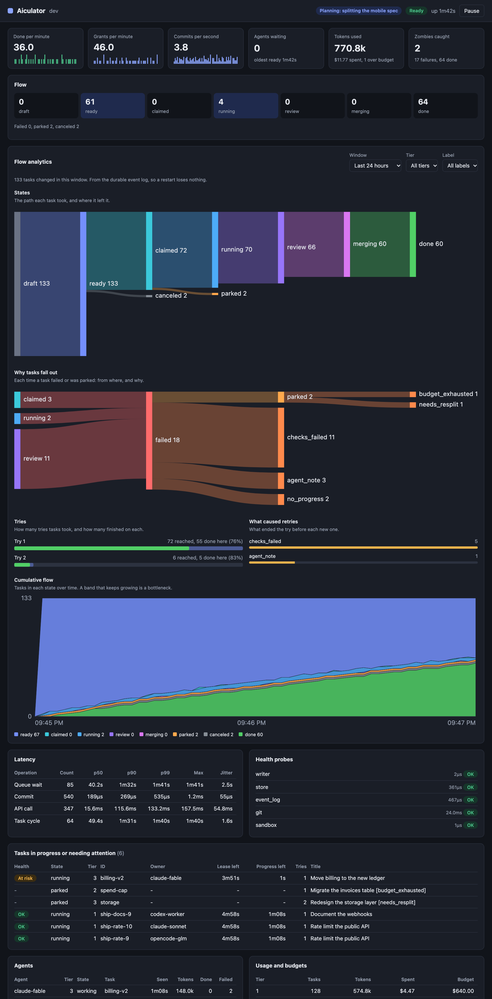
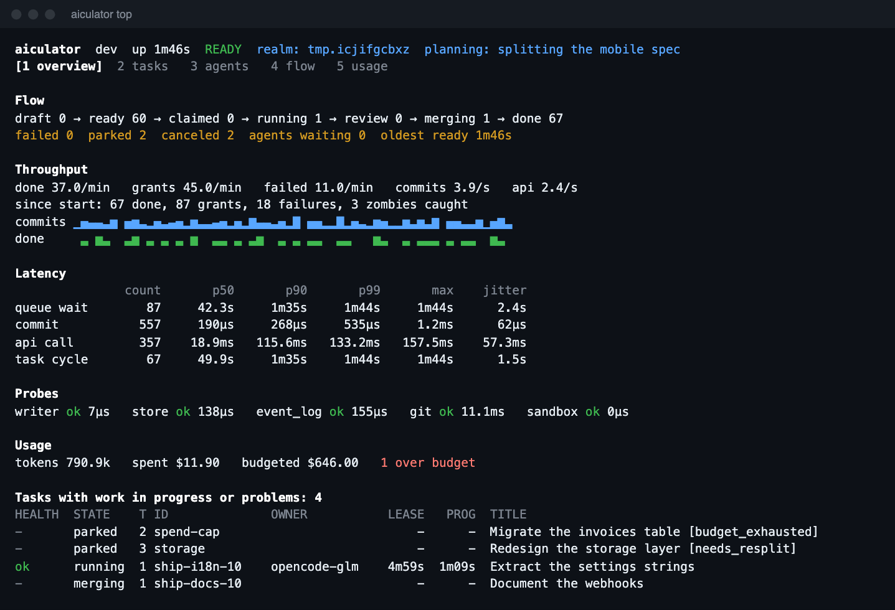
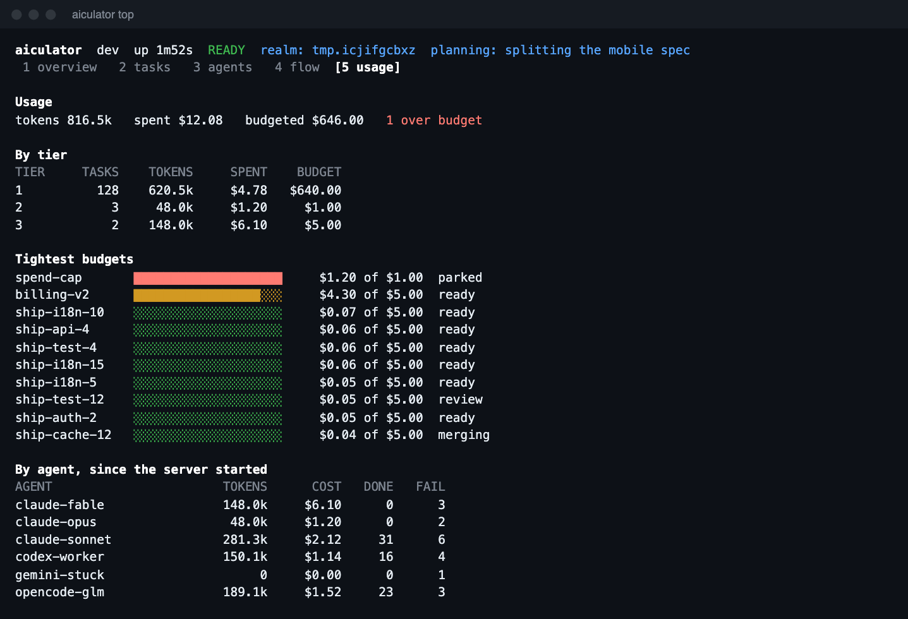
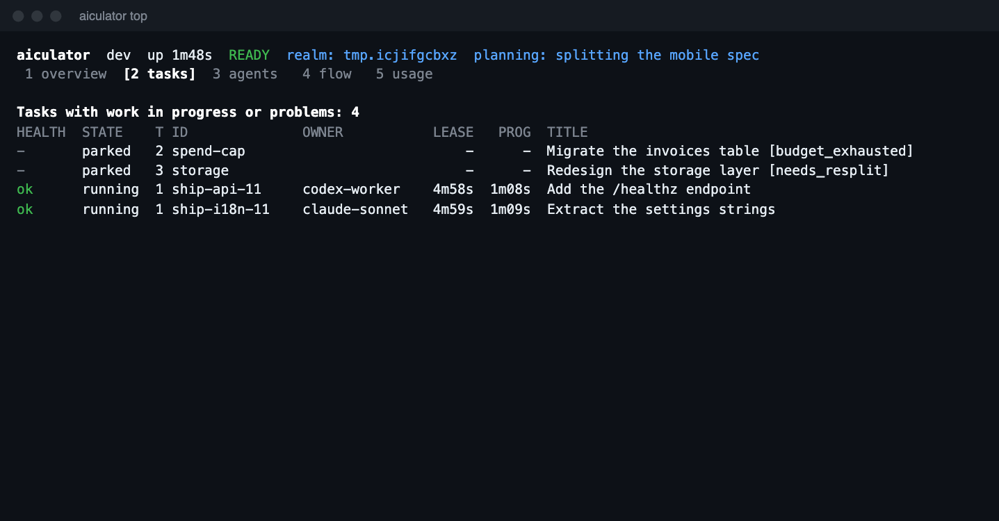

# Aiculator

One static Go binary that runs a queue of coding tasks across AI harnesses. It assigns each task to an agent of the right tier, isolates it in a git worktree and sandbox, verifies the result itself, and merges it.

An agent saying "done" counts for nothing: the swarm runs the acceptance checks.



<sub>A real server doing real work, from `scripts/screenshots.sh`. Agents were driven through the CLI, so token and cost figures are demo values.</sub>

**[Read the docs](https://grano22.github.io/aiculator/)**, which start with a showcase of what it does.

## Live dashboards

`aiculator top` shows flow, throughput, latency with jitter, health probes, usage and tasks in trouble, in your terminal. `aiculator web` shows the same in your browser, compiled into the binary, with a read-only link.



<p>
  
  
</p>

## Quick start

```sh
# Or download a binary from the releases page, or: go install github.com/Grano22/aiculator/cmd/aiculator@latest
# Static on Linux. macOS does not allow static binaries, so there it links system libraries.
CGO_ENABLED=0 go build -trimpath -ldflags='-s -w' -o bin/aiculator ./cmd/aiculator
export PATH="$PWD/bin:$PATH"     # The skills call aiculator by name.

cd /path/to/your/repo
aiculator join --tier 1          # Server, skills and MCP config for every installed harness
aiculator task add --title "Add a health endpoint" \
  --spec "Add GET /healthz returning 200." --check "go test ./..."
aiculator task ls
aiculator top                    # Watch it live
```

Finished work lands on the `swarm/integration` branch. Your own branches are never touched.

## Three ways to work the queue

| Route | Use it when | Restart? | Sandbox? |
|---|---|---|---|
| **Shell:** `aiculator work ...` | A session is already open, or the harness has no MCP (Pi, goose) | No | No |
| **MCP:** written by `aiculator join` | A new session in any harness with a project MCP file | Yes, MCP loads at start | No |
| **ACP:** `aiculator drive --harness ID` | You want workers launched for you, with no model turns while idle | Not applicable | Yes |

To join from a session that is already open, paste this into it:

```text
Read .agents/skills/swarm-join/SKILL.md and follow it. Join as tier 1.
```

In a new session, use the `swarm-join` skill (`/swarm-join 2` in Claude Code for tier 2). `swarm-plan` feeds the queue and keeps waiting workers informed, and it needs `aiculator join --planner` for its MCP tools. `swarm-operate` runs the server and launches workers. Both routes offer the same worker operations: wait, claim, heartbeat, progress, submit, fail, release, review and situation.

A joined session runs under its harness's own permissions, outside the swarm's sandbox. The swarm still runs the acceptance checks itself, in a sandbox. For untrusted work, use `aiculator drive`.

## Skills in one place

Skills live in `.agents/skills/`, the cross-client convention from [agentskills.io](https://agentskills.io). Harnesses that scan it need nothing, and the rest get a link, so an edit reaches every harness. `.agent/skills/` is read as well, and its skills are linked into `.agents/skills/`, because that is the path harnesses actually scan.

```sh
aiculator skill --install '*'                  # All skills, to every installed harness
aiculator skill --install 'swarm-*' '*-tool'   # By pattern: * anything, ? one character, [abc] a set
aiculator skill --install '*' --global         # ~/.agents/skills and home directories
aiculator skill --install '*' --harness all    # Every supported harness, installed or not
aiculator skill --install x --harness claude,pi
aiculator skill --install x --path ./vendor/skills --harness none   # A custom target
aiculator skill --install x --source ~/my-skills                    # A custom source
aiculator skill --list                         # Versions, lint state, who can see what
aiculator skill --lint                         # Check against the Agent Skills spec
aiculator skill --new my-skill --description "..."
aiculator skill --uninstall 'swarm-*' --purge
```

Quote patterns. A bare `*` also works: the shell expands it to the directory listing, and aiculator recognizes that exact list as "all". zsh stops with an error on an unmatched unquoted `*-sth` before aiculator runs.

Your own directories are never replaced, even with `--force`. A skill that fails the linter is not linked anywhere.

### Skill metadata

Use the spec's fields first: `name`, `description`, `license`, `compatibility`, `metadata` (string values only) and `allowed-tools`. Fields below are honored by some harnesses and ignored by others, so they are safe in project skills, but claude.ai uploads and the Skills API reject them.

| Field or file | Honored by |
|---|---|
| `disable-model-invocation` | Claude Code, Cursor, Pi |
| `paths` | Claude Code, Cursor |
| `when_to_use`, `argument-hint`, `arguments`, `user-invocable`, `disallowed-tools`, `model`, `effort`, `context`, `agent`, `hooks` | Claude Code |
| `icon`, `color` | Cursor |
| `agents/openai.yaml` | Codex |

## Templates and MCP config

`aiculator template` renders reusable instructions into skills, using Jinja2 and MDX-style components such as `<Backoff retries="3" />`, `<Subagents>`, `<OutputFormat>` and `<Flow>`. Bundled templates make a model ask through a selectable list, checkboxes, tabs, yes or no, free text or previews, keep a live task list, get a plan approved first, format replies with rich Markdown, run staged subagent flows, and keep a status section current. [`.agent/template/demo.mdx`](.agent/template/demo.mdx) uses every feature at once.

`aiculator mcp add` and `aiculator mcp print` add a server to any harness or config file, or print the piece to paste. Both are covered in the docs under `docs/guides/`.

## Tasks from other platforms

Tasks can come from Jira, Notion, Excel or CSV as well as from harnesses. `aiculator import` loads them once, using a field mapping in `.agents/sources.yaml`, and the synchronizer keeps them in step in both directions. It runs beside the core, so a slow remote can't slow a claim. See [Connectors](docs/guides/connectors.md).

Tasks can also carry labels, properties, files and references to things elsewhere, and their priority can rise as they wait. See [Labels, priority and attachments](docs/guides/task-data.md).

## Harnesses

`aiculator harness` shows all 24 and their state on this machine.

| Harness | Skills | MCP config written by join | Run for real here |
|---|---|---|---|
| Claude Code | link in `.claude/skills` | `.mcp.json` | Yes: shell, MCP and ACP |
| Codex | native | `.codex/config.toml` | No |
| Gemini CLI | native | `.gemini/settings.json` | No |
| OpenCode | native | `opencode.json` | Yes: shell, MCP and ACP |
| Cursor | native | `.cursor/mcp.json` | No |
| GitHub Copilot CLI | native | `.mcp.json` | No |
| Pi, goose | native | None: shell route | No |
| Amp, Auggie, Cline, Continue, Crush, Devin, Droid, Grok, Junie, Kilo, Kimi, Kiro, Qwen, Roo, Vibe, Windsurf | From a community table, not their docs | None: shell route | No |

The first eight were checked against each harness's own docs. Only Claude Code and OpenCode have been run end to end, so treat the rest as untested until `scripts/gate3_real.sh ID` passes for them.

OpenCode 2 needs one extra step: a running background service does not pick up new project config, and `opencode mcp list` reports the service's view. Use `opencode run --standalone` or restart the service. The shell route works either way.

## How it works

- **Commit path:** one goroutine owns all state. Each command passes the pure state machine in `internal/core`, then one compare-and-swap write to KV, and only then wakes the waiter. The event log is derived from the KV stream, so a crash cannot leave the two disagreeing.
- **Dispatch:** `wait_for_task` returns a task already leased to the agent, so there is no claim race. Agents get `task`, `wait` with a reason, or `exit`.
- **Tiers:** a task goes to agents of its own tier. Higher tiers take it only after a set wait. Two failures raise the tier, and after the top tier the task is parked for a human.
- **Planner signal:** the planner takes a lease before reading its input and publishes its phase and expected tasks per tier. A plan becomes visible all at once when it commits. If the planner dies, the lease expires and waiters see `planner_lost`.
- **Zombies:** the swarm hashes the worktree itself. An agent with a live heartbeat and unchanged files loses its lease.
- **Handoff:** work is saved under `refs/swarm/<task>/`. A new attempt starts from there and first merges in whatever has landed since.
- **Secrets:** sandboxed commands cannot read the admin token, the signing key or credential stores such as `~/.ssh`. Harness config files hold no tokens: the MCP bridge gets one locally when it starts.
- **Harness faults:** a missing login or failed launch hands the task back with no penalty and stops that driver.

## Layout

| Path | Purpose |
|---|---|
| `internal/core` | Pure state machine and invariants |
| `internal/store` | Embedded NATS JetStream, KV and event log |
| `internal/engine` | Single writer, dispatcher, leases, planner lease |
| `internal/work` | Worktrees, saved work, checks, merge queue |
| `internal/sandbox` | Seatbelt, bubblewrap, Docker |
| `internal/auth` | ed25519 agent tokens |
| `internal/swarm` | Service that joins the engine and work layer |
| `internal/api` | HTTP and MCP endpoints |
| `internal/driver` | ACP driver and permission policy |
| `internal/harness` | Registry of harnesses, and MCP config writers |
| `internal/skillpack` | One-place skills, wildcard install, linter, bundled skills |
| `internal/tmpl` | Templates, components and rendering |
| `internal/meta` | Properties, blobs and foreign resources |
| `internal/connect` | Import and two-way sync with other platforms |
| `internal/tui` | The terminal dashboard |
| `pkg/observe` | Public: live metrics |
| `pkg/plugin` | Public: the plugin API |
| `plugins/webdash` | The web dashboard plugin |
| `cmd/aiculator` | The binary, and the `kill -9` gate test |
| `cmd/fakeagent` | ACP agent that is slow, crashes, goes zombie or lies |

## Tests

```sh
go test -race ./...                                 # Includes the 100-crash gate
go test ./internal/core -run=^$ -fuzz=FuzzApply -fuzztime=60s
go test ./internal/engine -run=^$ -bench=GrantCycle
./scripts/license_audit.sh                          # Regenerates THIRD_PARTY_NOTICES.md
./scripts/gate2_claude.sh                           # Uses your Claude account
./scripts/gate3_real.sh claude 3                    # Any harness id; uses that account
./scripts/gate_ui_templates.sh                      # Do the UI templates steer a real model?
ROUTE=mcp ./scripts/gate_join.sh                    # Real session joins using only join's output
ROUTE=shell ./scripts/gate_join.sh                  # The same, for a session already open
HARNESS=opencode ROUTE=mcp ./scripts/gate_join.sh   # The same, in OpenCode with a free model
```

## Formal verification

```sh
./scripts/formal.sh   # Downloads pinned tools into .tools; needs Java
```

| Model | What it covers |
|---|---|
| `spec/tla/Swarm.tla` | Lifecycle with crashes, lost replies and zombies: unique leases, fencing, done means independently verified |
| `spec/tla/SwarmLiveness.tla` | A task always ends done or parked, even with hostile agents |
| `spec/tla/Planner.tla` | An agent told to exit never misses work from that plan |
| `spec/alloy/swarm.als` | Tier and tag eligibility, plan deadlocks, file lease conflicts |

Models named `Bug` break a rule on purpose and must fail, which shows the checker can catch that defect. `TestSpecMatchesCode` fails the build if the TLA+ transition table and `core.Apply` disagree.

These results are bounded: they hold for the model and the sizes in each `.cfg` file and `check` command. Only the transition table is tied to the code mechanically. The other rules in the models were written by hand from the code, and the tests have to cover that gap.

## Plugins

Compile plugins in with a registry (`pkg/plugin`), put a program named `aiculator-NAME` on your `PATH`, or follow `aiculator events` from any language. The web dashboard is itself a plugin; `go build -tags noweb` leaves it out. See `docs/guides/plugins.md`.

## Debugging

Verbosity works like kubectl: `-v=0` to `-v=9`, and `--vmodule engine=5` for one component. `aiculator debug verbosity 5 --for 10m` changes a running server and goes back by itself, and `aiculator logs -f` follows it. Credentials never reach a log. See `docs/guides/debugging.md`.

## Docs and releases

The full docs are in `docs/` and publish to GitHub Pages. To read them locally, with Python 3.10 or newer:

```sh
python3 -m venv .venv && .venv/bin/pip install -r docs/requirements.txt && .venv/bin/mkdocs serve
```

To release, keep `CHANGELOG.md` current, then run `scripts/release.sh --bump minor --push`. See `docs/project/releasing.md`.

## Licenses

`scripts/license_audit.sh` fails the build on GPL, AGPL, LGPL, BSL, SSPL or unknown licenses in anything linked into the binary. `THIRD_PARTY_NOTICES.md` carries the required license texts and NOTICE files, and must ship with the binary.

Harnesses and sandboxes run as separate programs and are not linked. Each has its own license and terms of use.

Aiculator itself is released under the [MIT License](LICENSE).
