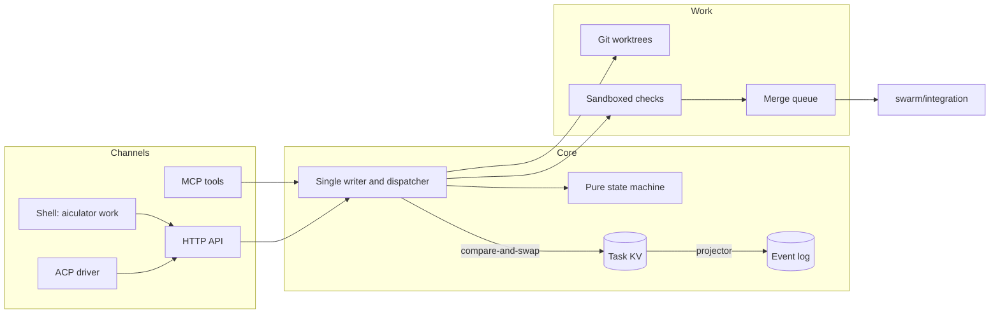

# Architecture

Aiculator is one Go binary with embedded NATS JetStream. It needs no external services.

## The commit path

One goroutine owns all task state:

1. A command reaches the writer, and a pure function, `core.Apply`, checks that it is legal.
2. The writer makes one compare-and-swap write to the task's key. This is the commit point.
3. Only after that write is acknowledged does it wake whoever is waiting.
4. A projector follows the KV stream and writes the event log, using `task:revision` as the message ID so that replays are safe.

Since there is only one commit point, a crash cannot leave the state and the log disagreeing for good. Everything else in memory is rebuilt from KV on startup.

## Dispatch

`wait_for_task` returns a task already leased to the agent, so there is no second round trip and nothing to race for. New tasks wake only as many agents as there are tasks.

Priority aging needs no re-sorting. Each ready task has a fixed key, priority times the aging unit minus the time it became ready, and comparing those keys gives the same order as comparing priority plus waiting time at any moment.

## Channels hold no state

MCP, the shell commands and the ACP driver all call the same service, so they behave the same. Agent identity always comes from a signed token and never from a request's arguments.

## Leases run on the writer's clock

The NATS per-key TTL can be set only when a key is created, and a fake clock cannot control it. So leases run on the writer's own clock, which makes them testable. The TTL is used only to show which agents are around.

## Worktrees and saved work

Each attempt gets its own worktree. The swarm saves work under `refs/swarm/<task>/`, using a private index so that it does not disturb the agent's staged files. A new attempt starts from the saved work and merges in whatever has landed since.
