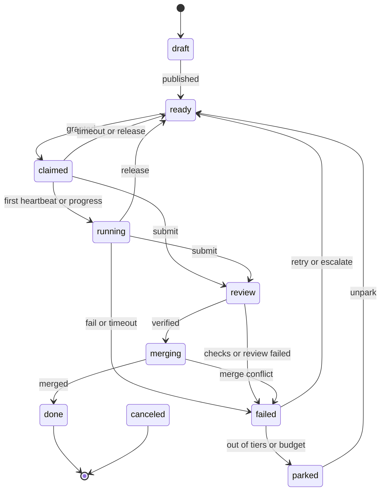

# Tasks and tiers

## Lifecycle

Any state except `done` can also move to `canceled`.

## Tiers

A tier is a number, and which model counts as which tier is your choice, set in the agent's token.

| Tier | Typical work | Takes lower-tier tasks |
|---|---|---|
| **1 Standard** | Mechanical edits, tests, docs | None lower |
| **2 Advanced** | Multi-file features, debugging, reviews | Tier 1 tasks, after 2 minutes |
| **3 Ultra** | Architecture and the hardest problems | Tier 2 tasks, after 5 minutes |

Eligibility also needs the task's tags, and no overlap between its `--touches` paths and those of work in progress.

## What happens on failure

1. Two failures raise the task's tier.
2. The next attempt inherits the saved work and the earlier notes, marked as untrusted.
3. After the top tier fails twice, the task is parked with the reason `needs_resplit`, for a human or a planner.

A task that goes over its budget is parked with `budget_exhausted`. `aiculator task unpark ID --add-budget N` returns it to the queue.

A claim that times out before work starts costs nothing, and neither does a `release`.

## Zombies

A heartbeat shows only that an agent is alive. Progress is measured separately: the swarm hashes the worktree itself, and only a changed hash counts. An agent with a live heartbeat and unchanged files loses its lease when the progress timeout runs out, which is 10 minutes by default. Its late submit is refused, and its saved work goes to the next attempt.
