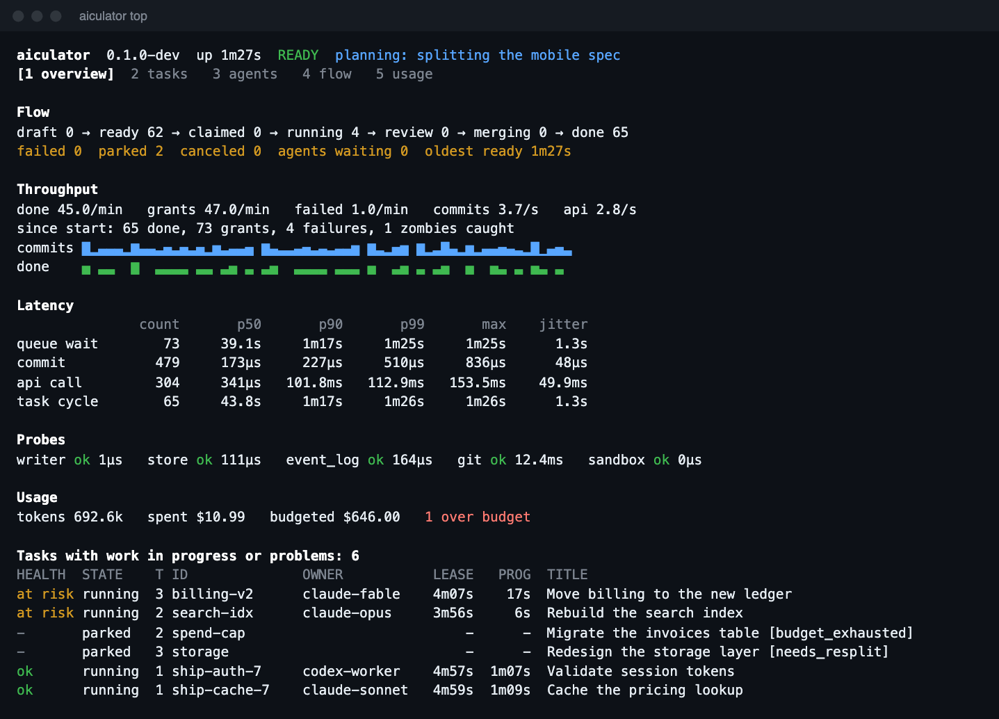

# Dashboards

There are two live views of the same data: `aiculator top` in a terminal, and `aiculator web` in a browser. Both are read-only.

## Terminal

```sh
aiculator top
```



| Key | Action |
|---|---|
| `1` to `5`, or `tab` | Switch between overview, tasks, agents, flow and usage |
| `↑` `↓`, or `j` `k` | Scroll |
| `p` | Pause |
| `q` | Quit |

Without a terminal, it prints one frame and exits, so it works in scripts:

```sh
aiculator top --once --view usage
aiculator top --json | jq '.usage.tokens'
```

`--no-color` and `NO_COLOR` turn color off. Status is always in words as well as color.

## Web

```sh
aiculator web             # Opens your browser
aiculator web --no-open   # Prints the link
aiculator web --ttl 1h    # Expires sooner; the default is 12 hours
```


It follows your system's light or dark setting, works at phone width, and pauses while its tab is hidden.

The dashboard is a [plugin](plugins.md) compiled into the binary. `go build -tags noweb` leaves it out, saving about 0.1 MiB.

## What the numbers mean

### Flow

How many tasks are in each state, and how often tasks have moved between states. Many `running → failed` moves mean agents are struggling, and `merging → failed` means merge conflicts.

### Throughput

Rates over the last minute, with per-second history for the last 60 seconds.

### Latency and jitter

| Row | Measures | What a high value means |
|---|---|---|
| **Queue wait** | From ready to granted | Not enough agents |
| **Commit** | One durable write | The disk or the store is struggling |
| **API call** | One call, leaving out long-polls | The server is struggling. `progress` and `submit` are slower by nature, because they save work with git. |
| **Task cycle** | From created to merged | Tasks are slow or retrying |

Jitter is how much consecutive samples differ, smoothed the way RFC 3550 does for network jitter. High jitter with a low median points to occasional stalls.

### Health

Each task holding a lease is one of:

| Health | Meaning |
|---|---|
| **OK** | Plenty of time left |
| **At risk** | Under a quarter of its lease or progress time remains |
| **Expired** | Past its deadline, and about to be taken back |

"Progress left" counts down until the agent must change files. An agent that heartbeats without changing anything runs out of this and is caught as a zombie. Problems sort to the top, and the list holds at most 200 tasks.

Agents are `working`, `waiting`, `idle` or `gone`, which means not seen for 30 seconds.

### Probes

| Probe | Checks |
|---|---|
| `writer` | The engine answers |
| `store` | The state store answers |
| `event_log` | The event log is keeping up |
| `git` | The repository and integration branch are readable |
| `sandbox` | Which sandbox checks run in |

### Usage and budgets

Tokens come from harnesses that report them over ACP, or from `--tokens` and the `tokens` tool argument. **Cost is only what agents report,** in micro-dollars, because the swarm does not know your prices. It reads zero when nothing reports it.

Totals by task and tier come from durable state, so they survive a restart. Rates and per-agent figures start again when the server restarts.

## For other tools

| Endpoint | Token | Use |
|---|---|---|
| `GET /v1/healthz` | None | Is the process up |
| `GET /v1/readyz` | None | Is it ready. Returns 503 if a probe fails, with no details. |
| `GET /metrics` | Viewer | Prometheus format |
| `GET /v1/observe` | Viewer | The full snapshot as JSON |
| `GET /v1/events` | Viewer | Every task change, as JSON lines |

Create a read-only token for a scraper with the API's `/v1/tokens` route, setting `viewer: true`. `aiculator web --no-open` also prints one in its link.

```sh
aiculator events | jq -r 'select(.state == "parked") | "\(.id): \(.reason)"'
```

## Security

- Viewer tokens can read but cannot add tasks, take work or mint tokens.
- The page and its scripts hold no data, so they need no token. All data does.
- The link's token sits in the URL fragment, which browsers never send to a server. The page then removes it from the address bar and keeps it only for that tab.
- A strict content security policy blocks anything from elsewhere and anything inline.
- Task titles and agent names come from agents, so they are untrusted. The web page only ever renders them as text, and the terminal view strips control characters so they cannot steer your terminal.
