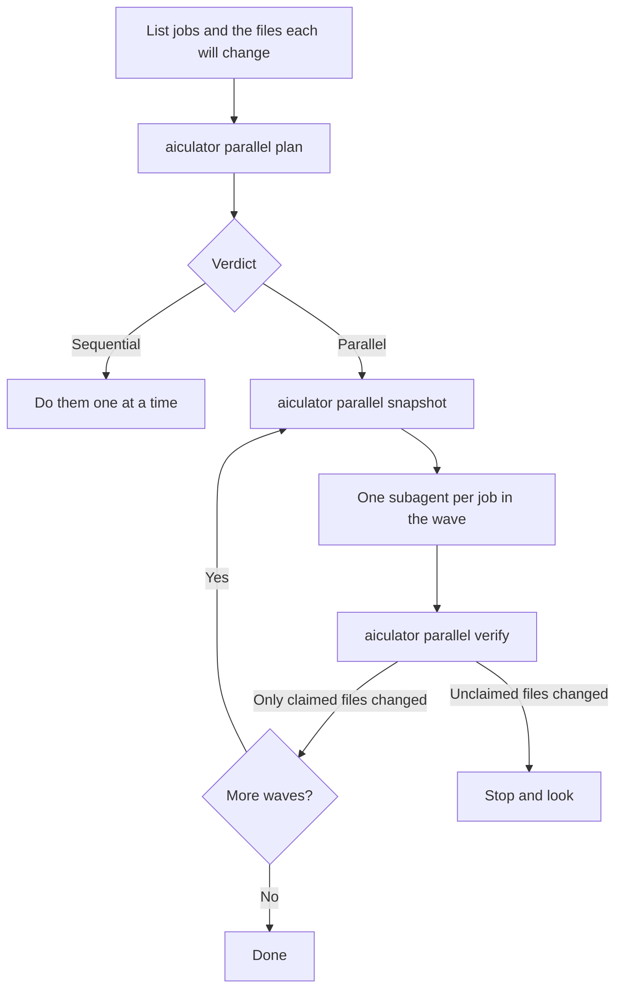

# Parallel subagents in one worktree

The swarm keeps work apart at three levels:

| Level | Keeps apart | How |
|---|---|---|
| [Realm](realms.md) | Projects | Separate servers and stores |
| Worktree | Tasks | Separate checkouts, reviewed and merged one by one |
| **Wave** | Subagents within one task | The same checkout, with claims that cannot overlap |

Worktrees are the stronger separation, and the right choice for separate tasks. A wave is for one piece of work that splits into parts, where a merge would be overhead. There is no merge step to catch a collision, so `aiculator parallel` is deliberately cautious.



## Use it from a session

`aiculator init` installs the `swarm-parallel` skill, which walks a model through all of this. To change how it behaves, use the `parallel-subagents` template or the `<ParallelWork>` component instead:

```sh
aiculator template --install parallel-subagents --set max=3
```

```html
<ParallelWork max="3" title="Split the build" />
```

## Use it by hand

```yaml
# jobs.yaml
jobs:
  - id: api
    touches: [internal/api/users.go, internal/api/users_test.go]
  - id: db
    touches: [internal/db/users.go]
  - id: docs
    touches: [docs/users.md]
    reads: [internal/api/users.go]
  - id: format
    exclusive: true
    deps: [api, db, docs]
```

```text
$ aiculator parallel plan --file jobs.yaml -o plan.json
Parallel: 4 jobs in 3 waves, compared at dir level.
  Wave 1: api, db
  Wave 2: docs
  Wave 3: format
```

| Field | Meaning |
|---|---|
| `touches` | What the job writes: a file, or a directory ending in `/` |
| `reads` | What it relies on staying the same while it works. A write conflicts with this, and two reads don't |
| `deps` | Jobs that must finish in an earlier wave |
| `exclusive` | Runs alone, as for a formatter or a dependency install |
| `weight` | Rough size. Jobs with the longest chain after them go first |

A job with no `touches` runs alone, because nothing says where it will write. Run the wave with one subagent per job, and check it afterwards:

```sh
SNAP=$(aiculator parallel snapshot)        # Before the wave. Stages and commits nothing.
aiculator parallel verify --plan plan.json --wave 1 --since "$SNAP"
```

`verify` exits with 1 if a file changed that no job in the wave claimed. It also lists jobs that changed nothing, which can mean a subagent didn't do its work.

## Granularity

| Level | Two jobs conflict if they share | Use |
|---|---|---|
| `repo` | Anything | Everything runs one at a time |
| `dir` | A directory | The safest level that still allows parallel work |
| `file` | A file | Most work |
| `symbol` | A symbol or line range in a file | Only when you ask for it |
| `auto`, the default | | The coarser of `dir` and `file` that loses no parallelism |

!!! danger "Sharing one file is opt-in, on purpose"
    With `--granularity symbol`, `file#Charge` and `file#Refund` can share a wave, as can `file:1-10` and `file:20-30`. `auto` never does this. When we tested this on a real model and asked it to split one file, it made up symbols to fit, and the two subagents collided. So `auto` treats those claims as the whole file, and at `symbol` level a claim must exist: a symbol must appear in the file, and a line range must fit. That catches invented claims, but it can't keep a subagent inside its part.

## How the schedule is worked out

The planner builds a graph with an edge between any two jobs that conflict, and then fills waves, respecting `deps` and `--max`.

- **Up to 14 jobs:** an exact search over which jobs are finished, which finds the fewest possible waves. A test checks it against trying every assignment.
- **More than that:** a greedy schedule that puts the longest chains and most contested jobs first. It says if it can't prove the result is the shortest.

The same input always gives the same plan.

## What this does and doesn't guarantee

Guaranteed by tests on random job sets: no two conflicting jobs share a wave, every job runs exactly once, and nothing starts before what it depends on.

These limits remain:

- **It relies on the job list being honest.** A job that writes a file it didn't list isn't prevented from doing so. `verify` catches that afterwards, if no other job in the wave claimed the file.
- **`verify` works per file.** It can't tell which job in a wave changed a file, and it doesn't see files ignored by git.
- **Subagents are told, not forced, to keep to their files.** A sandbox per subagent would enforce it, and that's what worktrees are for.

## How well this works

`scripts/gate_ui_templates.sh` tests this on a real Claude Code session, using Haiku:

| Probe | Result on the real model |
|---|---|
| Three jobs on three files | Planned, ran three subagents in one turn, and verified |
| Two jobs on one file | Told `Sequential`, and made both edits itself, one at a time |

Other harnesses have not been tested this way.
