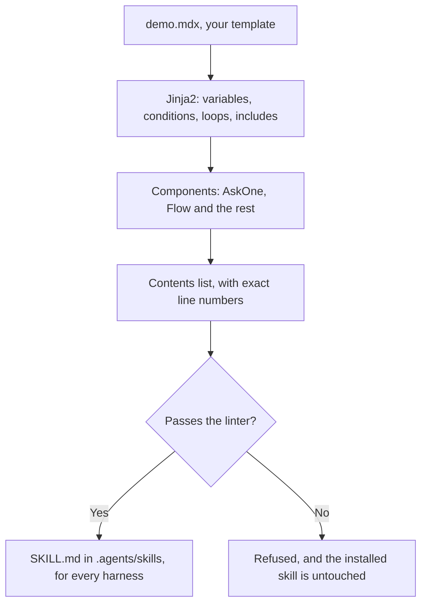
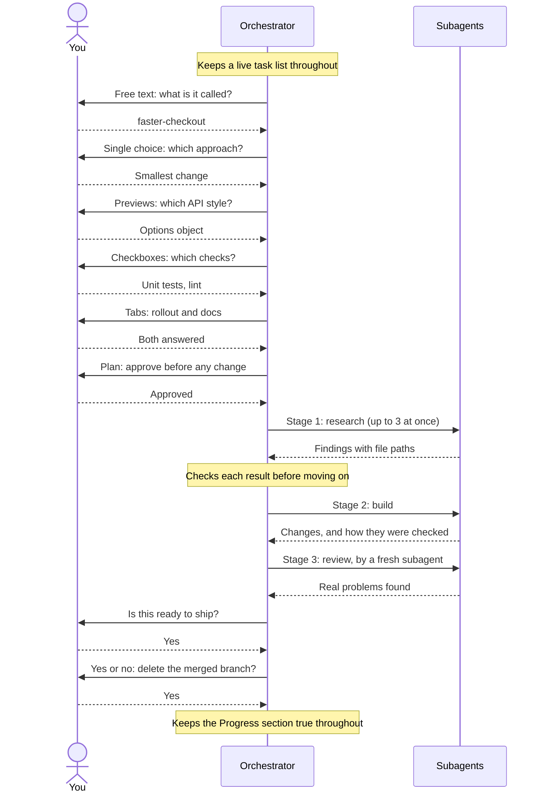

# :material-palette-swatch-outline: Template demo

One template that uses **every** template feature, in a realistic workflow: shipping a feature, from choosing an approach to opening the pull request.

<div class="demo-hero" markdown>
:material-file-code-outline: **Source:** `.agent/template/demo.mdx`

:material-sync: **Always current:** both the source and the output below are included from the real files, and a test fails if a new component is not used in the demo.
</div>

## Try it

```sh
aiculator template --render demo                 # (1)!
aiculator template --render demo --for claude    # (2)!
aiculator template --render demo --set retries=5 # (3)!
aiculator template --install demo                # (4)!
```

1. Prints the skill and writes nothing.
2. Shows what one harness's own copy looks like, naming its real question tool.
3. Overrides a default from the template's `vars`.
4. Writes it to `.agents/skills/demo`, and links it to each installed harness that needs a link.

!!! tip "Run this from a checkout of this repository"
    `demo.mdx` lives in this repository's `.agent/template`, so it is not bundled in the binary. To use it elsewhere, copy the `.agent/template` directory into your project.

## How it renders



## What a model does with it

The rendered skill leads a model through this conversation:



## The template

=== ":material-file-code-outline: Source"

    ```html+jinja title=".agent/template/demo.mdx" linenums="1"
    --8<-- ".agent/template/demo.mdx"
    ```

=== ":material-puzzle-outline: Partial"

    Included with ``.

    ```jinja title=".agent/template/partials/house-style.md"
    --8<-- ".agent/template/partials/house-style.md"
    ```

=== ":material-toy-brick-outline: Custom component"

    Used as `<DemoBadge label="...">...</DemoBadge>`. Props become variables, and the tag's content becomes `children`.

    ```jinja title=".agent/template/components/DemoBadge.md"
    --8<-- ".agent/template/components/DemoBadge.md"
    ```

## What it renders to

The same template, per harness. Compare "Track the work" and "Step F" across these tabs: each names what that harness really has.

=== ":simple-claude: Claude Code"

    Names `AskUserQuestion`, `TaskCreate` and `EnterPlanMode`.

    `````markdown title="aiculator template --render demo --for claude"
    --8<-- "demo.claude.md"
    `````

=== ":material-code-tags: OpenCode"

    Names `question` and `todowrite`. Its tool docs list no plan mode, so the plan is a numbered list.

    `````markdown title="aiculator template --render demo --for opencode"
    --8<-- "demo.opencode.md"
    `````

=== ":material-pi: Pi"

    No built-in tool is named for Pi, so the numbered lists and checklists do the work.

    `````markdown title="aiculator template --render demo --for pi"
    --8<-- "demo.pi.md"
    `````

=== ":material-share-variant-outline: Shared"

    One copy through links, so it cannot know the harness, and names all the tools.

    `````markdown title="aiculator template --render demo"
    --8<-- "demo.shared.md"
    `````

## Every feature, and what it does

<div class="grid cards" markdown>

-   :material-code-braces:{ .lg .middle } **Jinja2**

    ---

    Variables, conditions, loops, macros, filters, comments and includes. A typo in a variable name is an error.

-   :material-format-list-bulleted-type:{ .lg .middle } **Question types**

    ---

    A list, checkboxes, tabs, yes or no, free text or previews, using the harness's real tool.

-   :material-sitemap-outline:{ .lg .middle } **Subagent flows**

    ---

    Stages with inputs, outputs and a check before moving on.

-   :material-refresh:{ .lg .middle } **Retries**

    ---

    A timeout and a retry table the swarm computes for the model.

-   :material-format-list-numbered:{ .lg .middle } **Flows**

    ---

    Ordered steps, with questions and exceptions for subagents.

-   :material-pulse:{ .lg .middle } **Live sections**

    ---

    Text a model keeps true. A re-render keeps what it wrote.

-   :material-clipboard-check-outline:{ .lg .middle } **Task lists and plans**

    ---

    A live task list, and a plan the user approves first.

-   :material-language-markdown-outline:{ .lg .middle } **Rich Markdown**

    ---

    Rules for 19 Markdown forms, adjusted for terminals.

</div>

=== "Jinja2"

    | Feature | Where in the demo | Effect |
    |---|---|---|
    | `template: vars:` | Frontmatter | Defaults that `--set` overrides, removed from the output |
    | `{{ project }}` | The title | A variable |
    | `{# ... #}` | Throughout | A comment that never reaches the skill |
    | `` | `check_row` | A reusable piece, called from a loop |
    | `` | The first line | Differs per harness |
    | `` | "Step D" and "Checks to run" | Repeats for each item |
    | `` | House style | Shared text from another file |
    | `capitalize` | "Step D" | A filter, written after a pipe inside `{{ }}` |

=== "Questions"

    | Component | Where | The model is told to |
    |---|---|---|
    | `<AskText>` | Step A | Ask for the user's own words |
    | `<AskOne>` | Step B | Ask for exactly one choice |
    | `<AskPreview>` | Step C | Show an example of each option |
    | `<AskMany>` | Step D | Offer checkboxes, with `min` for at least one |
    | `<AskTabs>` and `<Tab>` | Step E | Ask everything in one call |
    | `<AskConfirm>` | Step H | Get a yes or no before a risky action |

    Each also says what to do with no question tool, and what a subagent should do instead of asking. Set that with `subagent="..."`.

=== "Workflow"

    | Component | Where | The model is told to |
    |---|---|---|
    | `<TodoList>` | "Track the work" | Keep a live task list |
    | `<PlanMode>` | Step F | Get a plan approved before changing anything |
    | `<Subagents>` | Before step G | Use subagents only in these cases |
    | `<SubagentFlow>` and `<Stage>` | Step G | Orchestrate stages, checking each result |
    | `<Backoff>` | After step G | Limit commands, and retry on this schedule |
    | `<Flow>` and `<Step>` | "Ship it" | Follow steps in order, one at a time |
    | `<OutputFormat>` | Near the end | Use this format in every reply |

=== "Rich Markdown"

    | Component | Where | The model is told to |
    |---|---|---|
    | `<RichMarkdown>` | "How to format your replies" | Follow the rules for each form, with `only` choosing which ones |
    | `<Render>` | "File references" | Follow one rule, with your own advice added as the tag's content |

    Set `surface` to `terminal` or `rich`. Try `--set surface=rich` to see diagrams and collapsible sections change. See [Forcing rich Markdown](templates.md#forcing-rich-markdown) for all 19 kinds.

=== "Navigation and rules"

    | Component | Where | Effect |
    |---|---|---|
    | `<Toc depth="2" />` | Top | Contents with exact line numbers and anchors, for `##` sections only |
    | `<Anchor>` | "Checks to run" | A searchable marker |
    | `<Directive>` | Top | A rule the model can cite by name |
    | `<Note>` | Top | A callout |
    | `<DynamicSection>` | The last two | Text the model keeps current, in the skill or in another file |
    | `<DemoBadge>` | Top | Your own component |

## Anatomy of a component

```html+jinja
<AskOne id="choose-approach" question="How should I build this feature?" subagent="Use the smallest change.">
- Smallest change (Recommended): touch as little as possible
- Refactor first: clean the area up
</AskOne>
```

| Part | What it does |
|---|---|
| `id` | Becomes the anchor in the contents list, so a model can jump straight here |
| `question` | Props become variables inside the component, and can use values from Jinja2, which runs first |
| `subagent` | Says what a subagent should do instead, since it cannot reach the user |
| The tag's content | Becomes `children`. Put your recommendation first |

??? question "Why two passes, Jinja2 and then components?"
    Jinja2 runs first, so `<Backoff retries="{{ retries }}" />` receives a real number. Components then expand, innermost first, so a `<Tab>` is ready by the time `<AskTabs>` uses it. The contents list comes last, because only then are the line numbers known.

??? question "What happens to tags in code examples?"
    They are left alone. The `<Flow>` in a code fence or in inline code stays exactly as written, so a skill can show examples of them.

??? warning "Do these force a model to behave?"
    No. They are instructions, and a model can still ignore text. On a real model the question types, task lists, plans, formatting rules, the subagent flow and live sections all worked as intended, which you can check with `scripts/gate_ui_templates.sh`. Anything that must hold needs a real check, such as a task's `--check` command.

## Make your own

- [ ] Copy `.agent/template/demo.mdx` to a new name, and change `name:` to match
- [ ] Keep the components you need, and delete the rest
- [ ] Preview with `aiculator template --render NAME`
- [ ] Install with `aiculator template --install NAME`
- [ ] Add `aiculator template --check` to CI, so that a changed template cannot go stale unnoticed

Or start smaller with `aiculator template --new my-rules`. See [Templates](templates.md) for the full reference.

*[MDX]: Markdown with component tags. These look like MDX, but they are expanded by aiculator.
*[Jinja2]: A template language, with variables, conditions and loops.
*[Orchestrator]: The main agent, which delegates to subagents and checks their results.
