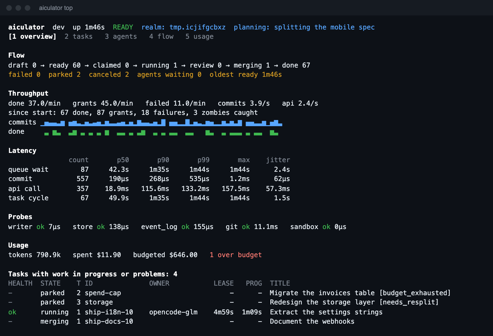
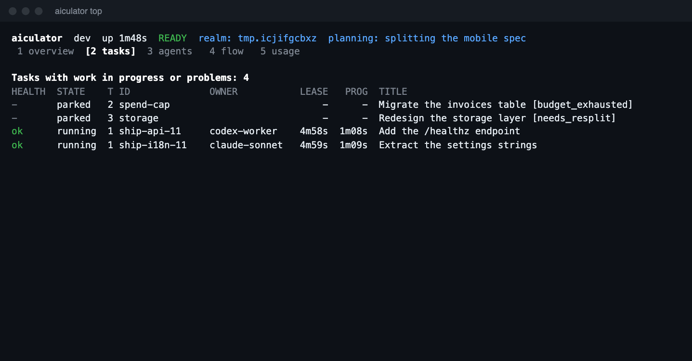
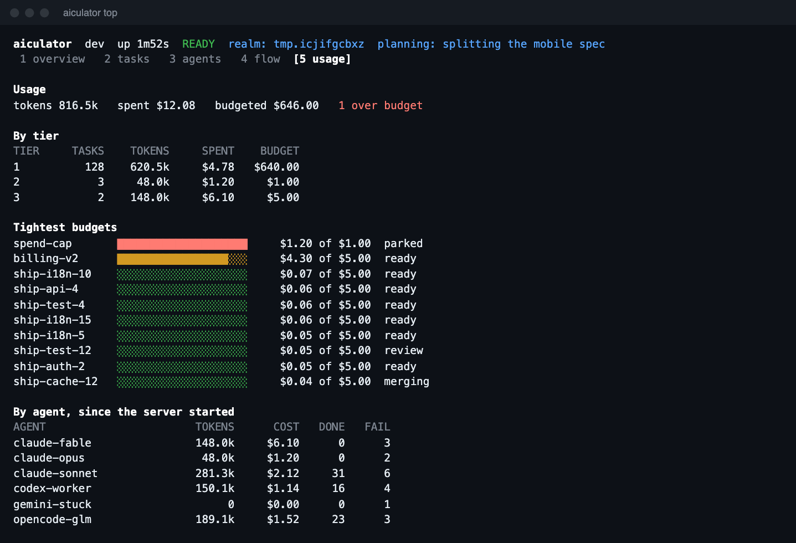
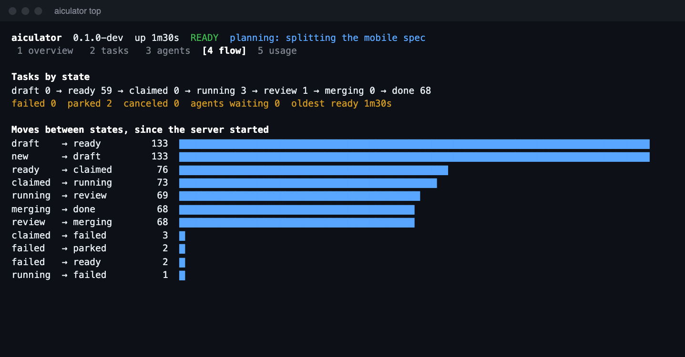
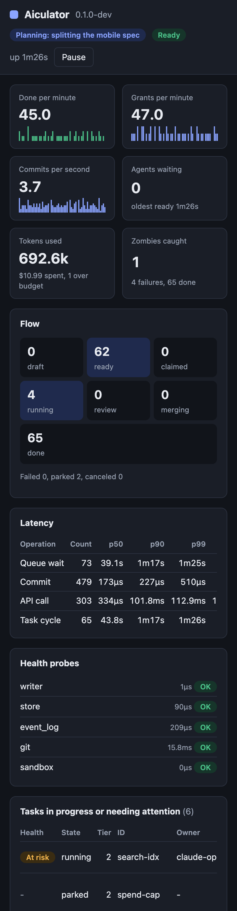

# Aiculator

Run a queue of coding tasks across AI harnesses, from one binary. Aiculator gives each task to an agent of the right tier, isolates the work in a git worktree, runs the acceptance checks itself, and merges what passes.

**An agent saying "done" counts for nothing.** The swarm verifies every result on its own.


<small>A real server doing real work, from `scripts/screenshots.sh`. Agents were driven through the CLI, so the token and cost figures are demo values.</small>

[Get started](getting-started/quickstart.md){ .md-button .md-button--primary }
[See what is built](project/status.md){ .md-button }

## See it work

### Connect a project and finish a task

```console
$ aiculator join --tier 1
Skills are in .agents/skills. Edit them only there.

claude     MCP in .mcp.json after a restart; shell works now
           Claude Code does not read .agents/skills, so it gets a link. It asks you to approve .mcp.json in interactive sessions.

In a NEW session, ask it to use the swarm-join skill (/swarm-join in Claude Code).
In a session ALREADY OPEN, paste this; it needs no restart:

  Read .agents/skills/swarm-join/SKILL.md and follow it. Join as tier 1.

$ aiculator task add --title "Add a health endpoint" \
    --spec "Add GET /healthz returning 200." --check "go test ./..."
```

An agent picks the task up, works in its own worktree, and submits. The swarm then runs `go test ./...` itself, in a sandbox, on a clean checkout. Only then does the work land on `swarm/integration`. Your own branches are never touched.

```console
$ aiculator task ls
ID          STATE     TIER TRIES OWNER          TITLE
j1          done      1    1                    Create note1.txt
j2          done      1    1                    Create note2.txt
j3          done      1    1                    Create note3.txt
```

### Watch it live in your terminal

`aiculator top` shows flow, throughput, latency with jitter, health probes, usage and which tasks are in trouble. It runs on its own with no setup.



=== "Tasks"

    

=== "Usage and budgets"

    

=== "Flow"

    

### Or in your browser, including on a phone

```console
$ aiculator web
```

The dashboard is compiled into the binary, with nothing to host or install. The link carries a read-only token that expires.



### Turn a harness you already have open into a worker

Paste one line into any session, with no restart:

```text
Read .agents/skills/swarm-join/SKILL.md and follow it. Join as tier 1.
```

Or launch sandboxed workers that use no model turns while idle:

```sh
SWARM_TOKEN=$(aiculator token --agent worker1 --tier 1) \
  aiculator drive --harness claude --agent worker1
```

### Keep waiting agents informed while planning

```console
$ aiculator plan begin --ttl 5m
{ "epoch": 1 }
$ aiculator plan update --epoch 1 --ttl 5m --phase "splitting the spec" --expected 1=8 --expected 2=2
```

Every waiting agent now gets this, so it knows whether to keep waiting or leave:

```json
{
  "action": "wait",
  "reason": "planning",
  "planning": { "epoch": 1, "phase": "splitting the spec", "expected_tasks": { "1": 8, "2": 2 } }
}
```

### Manage skills in one place

```console
$ aiculator skill --install 'swarm-*'
swarm-join     created  .agents/skills/swarm-join
swarm-join     linked   claude
swarm-join     native   opencode

$ aiculator skill --list
SKILL          VERSION  KIND      INSTALLED  LINT   HARNESSES        SOURCE
swarm-join     1.0.1    worker    yes        0e 0w  claude,opencode  .agents/skills/swarm-join
swarm-operate  1.0.0    operator  yes        0e 0w  claude,opencode  .agents/skills/swarm-operate
swarm-plan     1.0.0    planner   yes        0e 0w  claude,opencode  .agents/skills/swarm-plan
```

### Write instructions once, with templates

Reusable blocks for the rules you keep repeating. This template:

```html
<Subagents use="when" max="4" when="the work splits into independent parts"
  not_when="the steps depend on each other" />

<Backoff timeout="120s" retries="2" />

<Flow name="confirm before acting">
<Step n="1" title="Plan" ask="Does this plan look right?"
  subagent="Do not ask. Continue, and report your plan with the result.">
List the changes you intend to make.
</Step>
</Flow>
```

Renders to plain instructions, with the retry waits worked out and a contents list whose line numbers let a model jump straight to a section:

```markdown
## Contents

- Subagents: line 28, anchor `subagents`
- Commands: timeouts and retries: line 39, anchor `backoff`

## Commands: timeouts and retries

Give every command a time limit of **120s**. A command that hits the limit has failed; do not wait longer.

| Attempt | Wait before it |
|---|---|
| 1 | None |
| 2 | 2s |
| 3 | 4s |
```

### Make a model ask with a list, not a paragraph

Templates for single-choice lists, checkboxes, tabbed forms, staged subagent flows, and sections a model keeps current. On a real model, `ui-tabs` produced one call with three questions:

```text
Language  one of: Go (Recommended), TypeScript, Python
Database  one of: PostgreSQL (Recommended), SQLite, MongoDB, None
Hosting   one of: Fly.io (Recommended), AWS, Render, Self-hosted VPS
```

See [Templates](guides/templates.md#forcing-a-kind-of-question).

### Debug it the way you debug Kubernetes

```console
$ aiculator task ls -v=6
level=INFO msg=request v=6 component=client method=GET url=http://127.0.0.1:7777/v1/tasks status=200 took=1.1ms bytes=2

$ aiculator debug verbosity 5 --for 10m     # Trace a running server, then go back by itself
$ aiculator logs -f --component engine
```

Levels 0 to 9 mean what they mean in kubectl, and credentials never reach a log at any level. See [Debugging](guides/debugging.md).

### Add an MCP server to any harness

```console
$ aiculator mcp add --harness opencode --tier 2
$ aiculator mcp add --name docs --harness claude -- npx -y docs-server
$ aiculator mcp print --harness codex
```

### Extend it

```console
$ aiculator plugin
NAME     KIND         DESCRIPTION
webdash  compiled in  Web dashboard, embedded in the binary

$ aiculator events | jq -r 'select(.state == "done") | .id'
```

Compile plugins in, put a program named `aiculator-NAME` on your `PATH`, or follow the event stream from any language. See [Plugins](guides/plugins.md).

## Why it holds up

| What it does | How that was checked |
|---|---|
| **Survives crashes.** Nothing acknowledged is lost. | 100 real `kill -9` crashes in every test run, checking about 65,000 acknowledged writes |
| **Never hands a task to two agents.** | Porcupine linearizability checks, and TLA+ models of crashes and lost replies |
| **Catches zombies and liars.** | Fake agents that crash, hang or lie about being done |
| **Stays fast.** A wake takes 0.32 ms at p99, and a grant with 20,000 tasks queued takes 32 µs. | [Performance budgets](concepts/verification.md#performance-budgets) in CI |
| **Contains agents.** | Real sandbox escape attempts on macOS and Linux |
| **Stays small.** Archives are under 11 MiB. | A size budget every build enforces |

!!! warning "Early software"
    This is version 0.1. Only Claude Code and OpenCode have been run end to end, and several planned features are not built. See [Status](project/status.md) for exactly what works.

## Where next

<div class="grid cards" markdown>

-   **Start here**

    Install it and finish your first task in a few minutes.

    [Quickstart](getting-started/quickstart.md)

-   **Have a harness open already?**

    Join the swarm from that session.

    [Join from an open harness](guides/join.md)

-   **Watch it run**

    Every number on the dashboards, explained.

    [Dashboards](guides/dashboards.md)

-   **Curious how it stays correct?**

    See the crash tests and formal models behind it.

    [Verification](concepts/verification.md)

</div>
