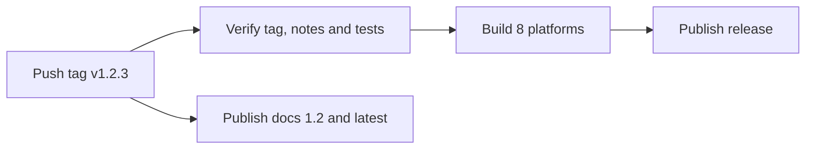

# Releasing

Releases are driven by semantic version tags. `scripts/release.sh` creates the tag, and pushing it does the rest.

## Make a release

1. Keep `CHANGELOG.md` current as you work, under `## [Unreleased]`.
2. Preview:

    ```sh
    scripts/release.sh --bump minor --dry-run
    ```

3. Create and publish:

    ```sh
    scripts/release.sh --bump minor --push
    ```

| Flag | Meaning |
|---|---|
| `--bump major\|minor\|patch` | The next version, from the latest stable tag |
| `--version X.Y.Z` | An exact version |
| `--pre rc.1` | A prerelease, such as `v1.2.0-rc.1` |
| `--push` | Push the commit and tag, which publishes |
| `--dry-run` | Show what would happen, and change nothing |
| `--allow-branch` | Release from a branch other than `master` |
| `--skip-tests` | Skip the local tests; CI still runs them |

Without `--push`, nothing leaves your machine, and the script prints how to undo it.

The script refuses a version that is not semantic or already exists, an empty `[Unreleased]` section, and uncommitted changes.

## What a tag does



- **Binaries:** Linux, macOS, Windows and FreeBSD, each on amd64 and arm64.
- **Each archive** includes the third-party license notices, which the dependency licenses require.
- **Also published:** `SHA256SUMS`, build provenance attestations, and notes taken from that version's changelog section.
- **Prereleases** are marked as such on GitHub, and do not change the `latest` docs.

Check an archive's provenance with:

```sh
gh attestation verify aiculator_v1.2.3_linux_amd64.tar.gz --repo OWNER/REPO
```

## Size budget

`scripts/build_release.sh` fails if a binary or an archive goes over budget, so neither CI nor a release can ship past it.

| Package | Budget | Current |
|---|---|---|
| Binary | 30 MiB | 24.6 to 27.7 MiB |
| Archive | 12 MiB | 9.2 to 11.1 MiB |

The template engine accounts for about 5.4 MiB of the binary, because real Jinja2 brings text-handling and JSON libraries with it. To raise a limit, change it in the script on purpose and say why in the commit.

## Docs

| Trigger | Publishes as |
|---|---|
| Stable tag `v1.2.3` | `1.2`, which also becomes `latest` |
| Prerelease tag `v1.2.3-rc.1` | `1.2.3-rc.1` |
| Push to `master` | `dev` |
| Run the Docs workflow by hand | The version and alias you give |

To work on the docs locally, with Python 3.10 or newer:

```sh
python3 -m venv .venv && .venv/bin/pip install -r docs/requirements.txt
.venv/bin/mkdocs serve
```

The pages in `docs/reference/` are generated. After changing a command or the harness registry, run:

```sh
go run ./cmd/aiculator gen-docs
```

## Screenshots

The images in the docs and README come from a real server doing real work:

```sh
./scripts/screenshots.sh   # About 90 seconds; needs Chrome and Node
```

## Set up a new repository

These are one-time steps on GitHub:

1. **Pages:** in Settings, set the source to the `gh-pages` branch. It appears after the first docs run.
2. **Actions:** in Settings, allow workflows to read and write, so that releases and docs can publish.
3. **Snyk:** add a `SNYK_TOKEN` repository secret. Until then, that scan is skipped.
4. **CodeQL:** code scanning results need a public repository or GitHub Advanced Security. The same goes for attestations on a private repository.
5. **Branch protection:** require the CI checks on `master`.

Dependabot starts on its own from `.github/dependabot.yml`.

## Automation in this repository

| Workflow | What it does |
|---|---|
| `ci.yml` | Race tests on Linux and macOS, lint, license audit, govulncheck, TLA+ and Alloy, fuzzing, builds for 8 platforms, docs build |
| `release.yml` | Tag to GitHub release |
| `docs.yml` | Versioned docs on GitHub Pages |
| `codeql.yml` | Code scanning for Go and the workflows |
| `snyk.yml` | Dependency scanning, when a token is set |
| `dependabot.yml` | Weekly updates for Go, Actions and docs dependencies |

Actions are pinned to full commit hashes, so a moved tag cannot change what runs.

## Package managers

Each release also goes to the package managers whose secrets are set. See [Package managers](packaging.md).
